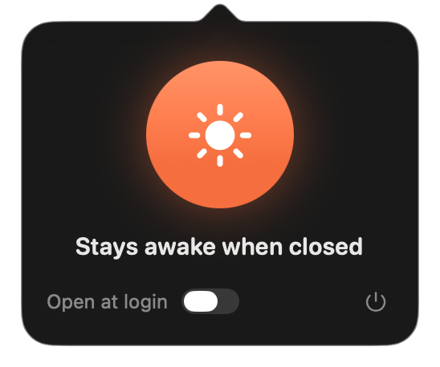

# NoNap

NoNap is a tiny macOS menu bar app for keeping a Mac awake when the lid is closed.

I built it because I wanted Codex, Claude, and other AI agents to keep working while my MacBook was closed. macOS can do this with `pmset`, but I wanted a small switch in the menu bar instead of remembering the command every time.



## What it does

- Keeps the Mac awake with `pmset -a disablesleep 1`
- Restores normal lid sleep with `pmset -a disablesleep 0`
- Always shows the real state, even if the setting was changed somewhere else
- Can open at login
- Stays out of the way in the menu bar

Click the menu bar icon for the switch, or right-click it for a quick menu. NoNap doesn't collect anything, phone home, or store secrets.

## Your password

The first time you flip the switch, NoNap asks for your administrator password once. It uses it to add one rule to `/private/etc/sudoers.d/90-nonap`, which lets your account run exactly these two commands without a password:

```
/usr/bin/pmset -a disablesleep 0
/usr/bin/pmset -a disablesleep 1
```

Any process running as your account can use that rule, and only for those two commands. The file is owned by root, checked with `visudo` before it goes in, and an existing file with different contents is never overwritten.

To remove it:

```sh
sudo rm /private/etc/sudoers.d/90-nonap
```

## Build

```sh
swift build -c release
```

To build and run the `.app` bundle:

```sh
./script/build_and_run.sh
```

The script writes the app bundle to `outputs/NoNap.app`.

To try the panel without touching the real power setting (debug builds only):

```sh
swift run NoNap --preview
```

To run the tests, which never change the power setting:

```sh
swift test
```

## Requirements

- macOS 26 or newer
- Swift 6.2 or newer (Xcode or the command line tools)
- A Mac where `pmset disablesleep` is supported

## Why not just use `caffeinate`?

`caffeinate` is great, but this is specifically for the lid-close sleep behavior. NoNap wraps the `pmset disablesleep` setting in a small menu bar UI so it is easy to see and toggle.

## License

MIT
